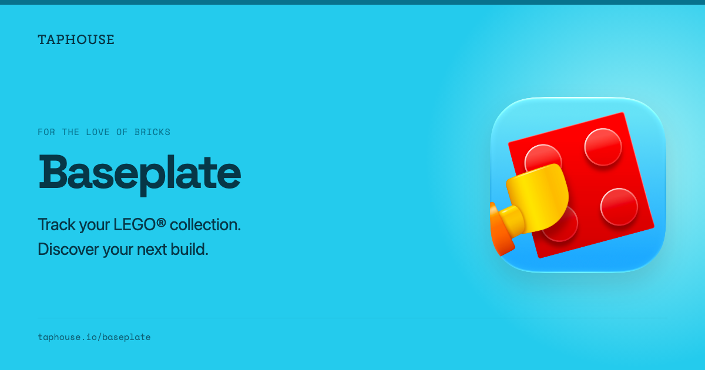
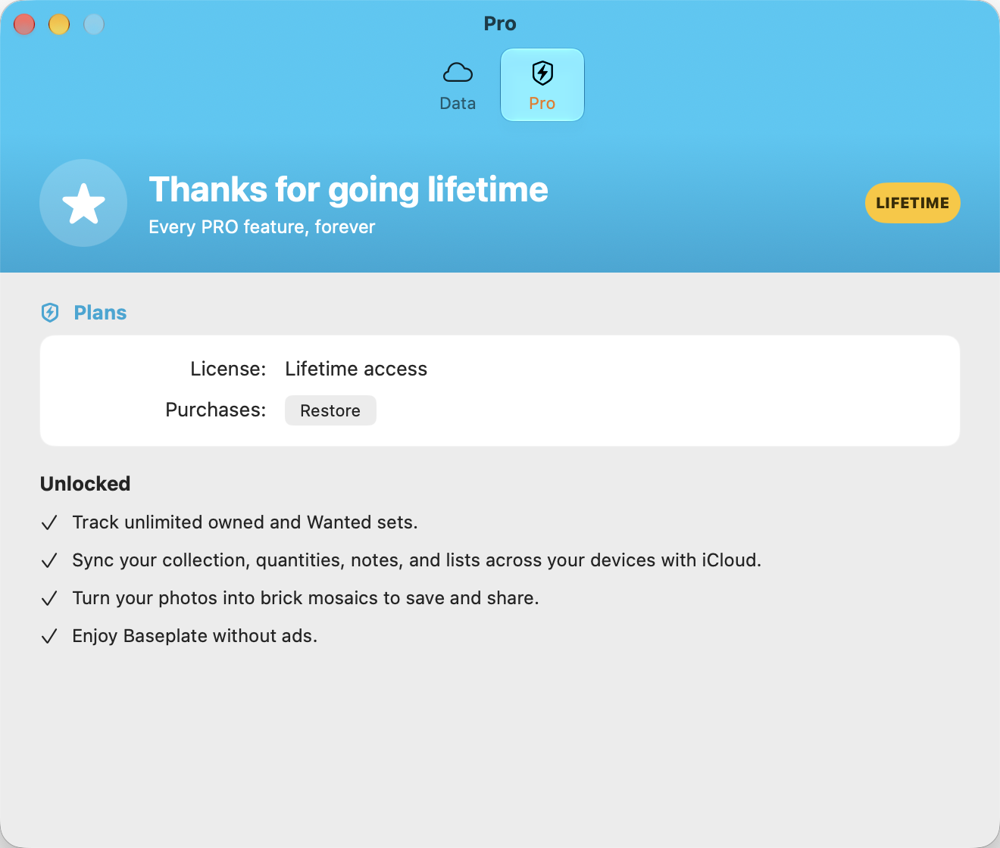

Several weeks ago I embarked on the journey of modernizing [Baseplate, my Lego collection app](https://taphouse.io/baseplate). It had a lot of custom UI that still looks really good but did not translate well to resizable iPhone apps, the iPad version did not lend itself well to multitasking and had some quirks, and the Mac version was but a larger iPad version and never really felt at home.

So I got to work thinking about how I could update the app to fill those gaps while also adding some features that had been on my mind to take the app to the next level.

## The Icon

What can I say, the old icon felt fine in iOS 18 and before but Liquid Glass did it no favors. It was pretty simple and the fuzzing of the glass texture made it feel off in iOS 26. So when The Iconfactory put up their [Indie App Icon deal](https://iconfactory.com/indie-icon-deal/) I thought about it for a couple minutes and jumped in. Boy howdy did they knock it out of the park!

It's just exquisite and even after living with it on my home screen for a few weeks it brings a smile to my face daily. I love the details they put in to it and I even went back to dark mode icons on my home screen because it looks good in dark mode too (it's great in the tinted and clear variants but that's just not how I choose to run my phone. YMMV of course.

## Information Architecture

Baseplate v1 started you off browsing sets, starting with Lego themes. While it had a tab bar and let you add sets to your collection, your collection was never the priority. I decided with v2 that I wanted that to change. Your collection is now the star of the show. It features the sets you've built and the sets you just own, but haven't built yet. I like this change because my collection makes me smile, and it's part of what keeps me coming back. You can also now track that you have multiples of a set too.

One thing I really liked about v1 was the use of color through the app to make certain elements pop, and I've kept that in the updated designs. I also was able to add set status for many sets as well, so you can at a glance see if a set is available to buy, retired, or even available for pre-order. I've got some ideas on how to build on this foundation too; this is but the start.

## Radar

If the collection is about what you have, then I wanted a place where you could see the things you know you want to add to your collection. This is the Radar tab, and it's got your wishlist (which used to be part of the collection and is now distinct) as well as sets just announced and released. The data isn't always perfect but I've found more often than not that the items listed to buy I can tap on the new buy button and be launched correctly straight away to the Lego site.

As with the Collection tab there's more to come here, and I've got some good ideas to help you keep on top of ordering your new builds.

## Subscription

Baseplate has always offered a subscription in monthly or yearly form. But this time I wanted to let users get more of a taste of the app before putting down their hard-earned money. So I added some new limits to both the Collection and Wishlist, and they can hold up to 10 sets in each. Browsing is also fully unlocked. I wanted to give users a bigger taste of the app and hope that it leads to more subscriptions. Whether this works or not is yet to be seen. Fingers crossed!

## Sync

One of the things that held me back from using Baseplate on my Mac or iPad was that the data didn't sync. It does now, provided you are a subscriber. The app now uses your iCloud account to sync across your devices and I have to say, this has been so nice to have during development. The first time I saw a set sync from my phone to my Mac it felt like magic. I'm using the [SQLiteData](https://github.com/pointfreeco/sqlite-data/) library from Point-Free and it's a delight to work with. Sync _just works_ and it's like magic. I did Core Data sync for Scorebook many years ago and that was a ton of work. I'm so thankful they put in the hard work to get sync right and I was able to turn it on with ease.

## The Mac

I love the Mac. I've been a Mac user since elementary school in the late 80's, and an aspiring Mac developer for the past decade. After putting out [Arborist](https://macarborist.com) a couple months ago I knew I wanted to treat Baseplate similarly, making it feel at home on the Mac. But it's not a dev tool, it's a fun tool, so I also had fun with it.

The app is still built with Mac Catalyst but has flares to make it feel at home on the Mac such as keyboard shortcuts and its own Settings window, which is where the paywall lives. I'm so over the moon happy at how this turned out because it's still fun while being a Mac app. And the accent color that The Iconfactory picked out works so well in the header too.

## Wrapping Up

Baseplate launched last week and the feedback I've gotten has been overwhelmingly positive. I'm already hard at work at v2.1 and want to add more deep platform integration as well as clean up a few things. I hope you'll check it out [on the App Store](https://apps.apple.com/us/app/brick-catalog-baseplate/id6737250348) and that it brings you as much joy as it brings me!